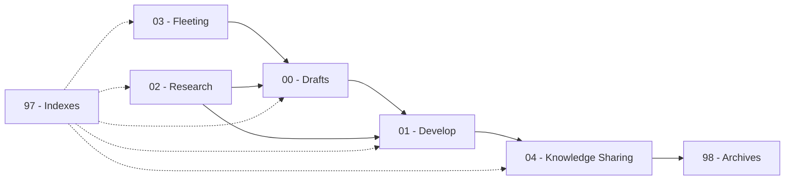

# Zettelkasten Knowledge Base

A Zettelkasten (German: 'slipbox', plural Zettelkästen) or card file consists of small items of information stored on Zetteln (German: 'slips'), paper slips or cards, that may be linked to each other through subject headings or other metadata such as numbers and tags.

## Daily Workflow (5-Minute Rule)

1. Capture ideas in **03 - Fleeting**
2. Process fleeting notes into **00 - Drafts**
3. Develop important drafts in **01 - Develop**
4. Promote finished work to **04 - Knowledge Sharing**
5. Archive inactive material in **98 - Archives**
6. Update **97 - Indexes** weekly

## Note Flow

## System Rules

- One idea per note
- Always link related notes
- Fleeting notes must be processed
- Only polished work goes into Knowledge Sharing
- Archives are read-only

## Quick Usage Guide

- Random thought? → 03 - Fleeting
- Messy first idea? → 00 - Drafts
- Improving an idea? → 01 - Develop
- From a book/article? → 02 - Research
- Ready for publishing? → 04 - Knowlege Sharing
- No longer active? → 98 - Archives
- Excalidraw or sketches? → _misc

## Knowledge Base Structure

<table>
   <tr>
       <td><strong>Folder</strong></td>
       <td><strong>Purpose</strong></td>
       <td><strong>What Goes Here</strong></td>
   </tr>

   <tr>
       <td>00 - Drafts</td>
       <td>Raw idea capture</td>
       <td>Unfinished thoughts, early writing, brain dumps</td>
   </tr>

   <tr>
       <td>01 - Develop</td>
       <td>Idea refinement</td>
       <td>Expanded notes, structured thinking, knowledge building</td>
   </tr>

   <tr>
       <td>02 - Research</td>
       <td>Source notes</td>
       <td>Book notes, articles, studies, references</td>
   </tr>

   <tr>
       <td>03 - Fleeting</td>
       <td>Temporary notes</td>
       <td>Quick thoughts, daily notes, reminders</td>
   </tr>

   <tr>
       <td>04 - Knowledge Sharing</td>
       <td>Final output</td>
       <td>Blog posts, tutorials, documentation, presentations</td>
   </tr>

   <tr>
       <td>05 - Other</td>
       <td>Miscellaneous</td>
       <td>Logs, experiments, uncategorized content</td>
   </tr>

   <tr>
       <td>96 - Images</td>
       <td>Media storage</td>
       <td>Diagrams, screenshots, illustrations</td>
   </tr>

   <tr>
       <td>97 - Indexes</td>
       <td>Navigation</td>
       <td>Maps of content, topic hubs</td>
   </tr>

   <tr>
       <td>98 - Archives</td>
       <td>Long-term storage</td>
       <td>Old projects, deprecated notes</td>
   </tr>

   <tr>
       <td>99 - Templates</td>
       <td>Note standards</td>
       <td>Reusable templates for notes</td>
   </tr>

   <tr>
       <td>_scripts</td>
       <td>automation</td>
       <td>helper scripts (e.g., tag formatting)</td>
   </tr>

   <tr>
       <td>_misc</td>
       <td>General artifacts</td>
       <td>Drawings, temporary visuals, other stuff </td>
   </tr>
</table>
